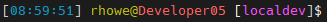
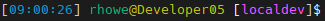
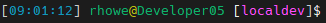
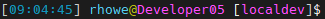
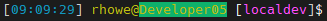
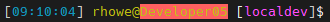

# Bash Color PS1

## Setup

These prompts require Bash and a terminal that supports ANSI colors. Install
`curl` to download the files. Run the setup commands in Bash; if you use another
shell, start `bash` first.

### Download and inspect

Download to a temporary directory so a failed transfer cannot overwrite an
installed prompt or append an error response to your startup files:

```bash
bash_ps1_download=$(mktemp -d) &&
curl -fL -o "$bash_ps1_download/bash_ps1" \
    https://raw.githubusercontent.com/ryanwhowe/bash_color_ps1/main/bash_ps1 &&
curl -fL -o "$bash_ps1_download/bash_aliases" \
    https://raw.githubusercontent.com/ryanwhowe/bash_color_ps1/main/bash_aliases &&
bash -n "$bash_ps1_download/bash_ps1" &&
bash -n "$bash_ps1_download/bash_aliases" &&
cat "$bash_ps1_download/bash_ps1" "$bash_ps1_download/bash_aliases"
```

Continue only if both downloads and syntax checks succeed. Read both files before
installing them: the activation snippet runs whenever your Bash startup loads it.
Syntax checks do not establish that downloaded code is trustworthy.

### Install or update

In the same Bash session, install the reviewed prompt file:

```bash
cp -- "$bash_ps1_download/bash_ps1" "$HOME/.bash_ps1"
```

Edit `~/.bash_aliases` (create it if needed) and paste the reviewed `bash_aliases`
snippet into it once. Its `# BEGIN bash_color_ps1` and `# END bash_color_ps1`
comments identify the activation block. Change `C_ENV="EXP"` inside that block
to your preferred preset from the table below.

For updates, repeat the download, inspection, and installation steps, then replace
the existing activation block with the reviewed version, retaining your chosen
`C_ENV`. Do not append another copy. If you used the earlier append command,
remove duplicate prompt blocks, including unmarked copies, while keeping unrelated
aliases. Leave exactly one activation block.

After installing and copying the snippet, remove the temporary downloads:

```bash
rm -r -- "$bash_ps1_download"
unset bash_ps1_download
```

### Load the prompt at startup

Inspect `~/.bashrc` to confirm it sources `~/.bash_aliases`. If it does not, add
this block once, after any other prompt assignments:

```bash
if [ -f "$HOME/.bash_aliases" ]; then
    source "$HOME/.bash_aliases"
fi
```

Open a new interactive Bash session, or load the configured preset immediately:

```bash
source "$HOME/.bash_aliases"
```

### Environment selection

Set `C_ENV` to one of these case-sensitive values before sourcing `.bash_ps1`:

| Value | Environment |
| --- | --- |
| `PROD` | Production |
| `TEST` | Testing |
| `DEV` | Development |
| `EXP` | Experimental (the startup snippet's default) |
| `LEADER` | Cluster leader node |
| `WORKER` | Cluster worker node |

An unset, empty, or unsupported value prints an error, clears `C_PROMPT`, and
returns a nonzero status. The startup snippet updates `PS1` only when sourcing
succeeds, preserving the current prompt if initialization fails.

To select a preset in the current Bash session:

```bash
C_ENV="DEV"
if source "$HOME/.bash_ps1"; then
    PS1="$C_PROMPT"
fi
```

This selects a preset only for the current session. Edit the activation block's
`C_ENV` assignment to make the selection persist in new sessions.

### Troubleshooting

- Confirm you are running Bash with `printf '%s\n' "${BASH_VERSION:-not Bash}"`.
- If the prompt is unchanged, verify `~/.bash_ps1` exists, check the
  `~/.bashrc` sourcing hook above, and reload `~/.bash_aliases`. Place that hook
  after other prompt configuration so later assignments do not replace `PS1`.
- For an `Invalid C_ENV` error, use an exact uppercase value from the table.
- Run `color_test` after activation to inspect terminal colors and styles.
  Bold, italic, and underline rendering depends on your terminal.

## Additional Aliases

### eza

```shell
alias eza="eza --icons --group-directories-first"
alias ls="eza"
alias ll="eza -l -g -h"
alias lla="eza -l -a -g -h"
alias la="eza -a"
```

### bat

```shell
alias bat="batcat"
alias cat="batcat"
```

* PROD - production environments

* TEST - testing environments

* DEV - development environments

* EXP - experimental environments



* LEADER - Cluster environments

* WORKER - Cluster environments

